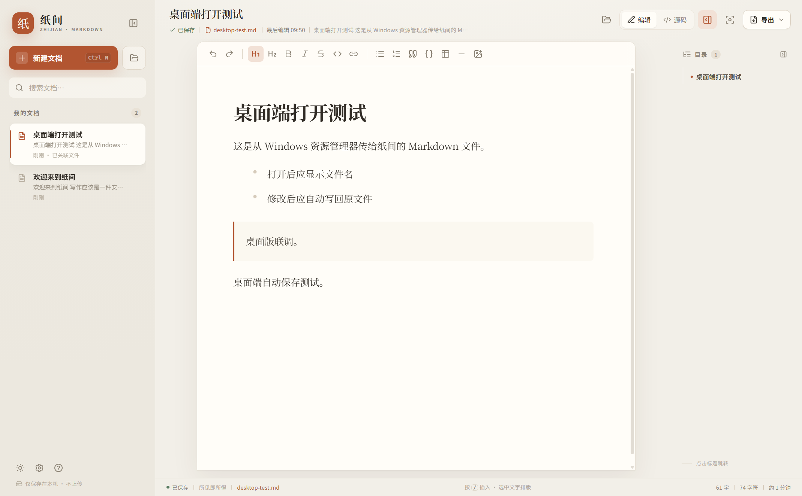
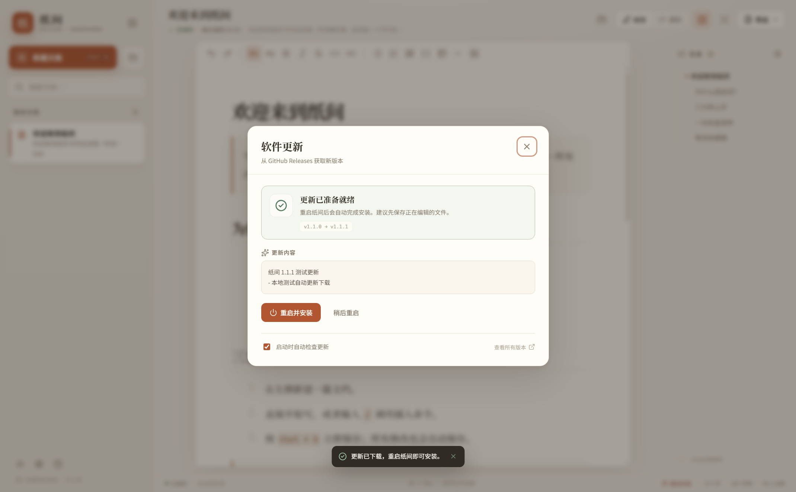

# 纸间 · 一个本地 Markdown 编辑器

一个安静、顺手、完全本地化的中文 Markdown 编辑器。  
默认所见即所得，需要时随时切换到 Markdown 源码 + 实时预览。



<p>
  <a href="https://github.com/AlexRaganhar/zhijian/releases/latest"></a>
  
  <a href="LICENSE"></a>
</p>

## 为什么是纸间

- **不学语法也能写**：加粗、标题、列表、引用都可以用顶部工具条；选中文字还会浮出格式工具条。
- **输入 `/` 插入**：标题、列表、待办、表格、代码块、公式、图片，都在一个菜单里。
- **源码模式**：左侧 Markdown、右侧实时预览；适合需要精确控制格式的时候。
- **本地文件直开**：桌面版可以直接打开 `.md` 文件，修改后自动写回原文件。
- **本地优先**：不登录、不上传文档、没有后端；只有检查更新时会访问 GitHub Releases。
- **文件闭环**：打开 `.md`，导出 `.md` / 独立 HTML，或直接打印成 PDF。
- **认真排版**：纸白、暖褐、夜间三套主题；衬线 / 无衬线字体；字号、行距、版心宽度均可调。
- **专注模式**：`Ctrl + Shift + F` 收起所有界面，只留下文字。
- **自动保存**：编辑内容自动保存；已关联文件会在 650ms 后写回磁盘。
- **自动更新**：安装版会从 GitHub Releases 检查更新，显示下载进度，并在合适的时候重启安装。

## 下载

不用安装 Node.js，直接下载 Windows 可执行文件：

| 文件 | 用途 | 下载 |
| --- | --- | --- |
| `Zhijian-1.1.0-setup.exe` | 安装版。创建开始菜单/桌面快捷方式，并注册 `.md` / `.markdown` 文件关联 | [下载](https://github.com/AlexRaganhar/zhijian/releases/download/v1.1.0/Zhijian-1.1.0-setup.exe) |
| `Zhijian-1.1.0-portable.exe` | 便携版。双击即用，不写注册表；数据保存在 exe 旁边的 `ZhijianData/` | [下载](https://github.com/AlexRaganhar/zhijian/releases/download/v1.1.0/Zhijian-1.1.0-portable.exe) |

> 所有版本见 [Releases](https://github.com/AlexRaganhar/zhijian/releases)。安装包未做代码签名，首次运行可能触发 Windows SmartScreen 提示。

### 安装版

双击 `Zhijian-1.1.0-setup.exe`，按提示安装即可。安装程序是**未签名**的，Windows SmartScreen 可能提示“未知发布者”，点击「更多信息」→「仍要运行」即可。

安装版注册文件关联后，在 `.md` 文件上双击或右键「打开方式 → 纸间」即可。  
如果系统仍然默认用 Typora 等旧程序打开，请在 **Windows 设置 → 应用 → 默认应用** 中把 `.md` 改为「纸间」，或在应用内「设置 → 文件关联 → 打开 Windows 默认应用设置」。

### 便携版

双击 `Zhijian-1.1.0-portable.exe` 即可启动，不需要安装。  
数据保存在 exe 同目录的 `ZhijianData/` 中，把 exe 和这个文件夹一起移动即可迁移。

便携版没有写入注册表，所以不会自动成为 `.md` 的默认程序。可以：

- 在便携版里点左上角「打开」选择文件；
- 把 `.md` 文件拖进窗口；
- 或右键 `.md` → 打开方式 → 选择 `Zhijian-1.1.0-portable.exe`。

也可以把 `.md` 文件作为参数传给 exe：

```powershell
.\Zhijian-1.1.0-portable.exe "D:\笔记\今天的想法.md"
```

### 桌面版的数据位置

- 安装版：Electron 的默认 `userData` 目录（通常在 `%APPDATA%\纸间`）。
- 便携版：exe 旁边的 `ZhijianData/`。
- `.md` 文件本身：就是你打开的原文件；修改会在 650ms 后自动写回。

桌面版和浏览器版共享同一套界面与编辑能力，但本地数据目录不同。

## 自动更新

安装版会从 [GitHub Releases](https://github.com/AlexRaganhar/zhijian/releases) 读取更新清单：

- 启动后约 5 秒检查一次，之后每 6 小时检查一次；
- 状态栏右侧显示当前版本和更新状态，点击可打开「软件更新」；
- 也可以在「设置 → 软件更新」中手动检查；
- 发现新版本后先下载，下载完成再由你选择什么时候重启安装；
- 可以在更新弹窗中关闭「启动时自动检查更新」。



便携版不支持自动替换 exe，会在更新弹窗中提示打开发布页手动下载；旁边的 `ZhijianData/` 不会被覆盖。

更新时会校验 `latest.yml` 中的 SHA-512 和安装包大小。目前安装包尚未做代码签名，建议只从本仓库的 Releases 页面下载。

## 浏览器版

如果只想在浏览器里使用，构建产物是单文件：

```text
dist/index.html
```

用 Chrome / Edge 双击打开即可。无需安装 Node.js，也无需启动服务器。  
浏览器版的文档保存在该页面的 `localStorage` 中；换浏览器、换电脑或移动文件位置时，请先通过「导出」保留 `.md` 备份。

> `file://` 下的 localStorage 与文件路径绑定。移动 `dist/index.html` 后，原路径下的文档不会自动跟过来。

## 开发

```bash
git clone https://github.com/AlexRaganhar/zhijian.git
cd zhijian
npm install
npm run dev
# http://127.0.0.1:5173/
```

构建浏览器单文件：

```bash
npm run build
# 产物：dist/index.html（样式、脚本、依赖全部内联）
```

运行桌面版：

```bash
npm run desktop
```

打包 Windows 安装版和便携版：

```bash
npm run dist:win
# 产物：release/Zhijian-1.1.0-setup.exe
#       release/Zhijian-1.1.0-portable.exe
#       release/Zhijian-1.1.0-setup.exe.blockmap
#       release/latest.yml
```

> 安装包体积超过 GitHub 单文件 100MB 限制，因此 `release/` 不进入 Git 仓库，而是作为 Release 附件上传。安装版自动更新依赖 `latest.yml` 和 `.blockmap`，发布时不要漏传。

技术栈：

- Electron 44 + Vite 8 + React 19 + TypeScript
- [Milkdown Crepe](https://milkdown.dev/)：所见即所得编辑
- CodeMirror 6：Markdown 源码编辑
- marked + marked-highlight + highlight.js + DOMPurify：预览、代码高亮与 HTML 导出
- `vite-plugin-singlefile`：浏览器版单文件打包
- `electron-builder`：Windows NSIS 安装版 / 便携版
- `electron-updater`：GitHub Releases 自动更新与差量下载

## 快捷键

| 操作 | 快捷键 |
| --- | --- |
| 新建文档 | `Ctrl + N` |
| 保存（桌面版写回文件） | `Ctrl + S` |
| 打开 Markdown | `Ctrl + O` |
| 切换源码模式 | `Ctrl + Shift + M` |
| 导出 HTML | `Ctrl + Shift + E` |
| 搜索文档 | `Ctrl + K` |
| 显示 / 隐藏侧栏 | `Ctrl + \` |
| 专注模式 | `Ctrl + Shift + F` |
| 加粗 / 斜体 / 行内代码 | `Ctrl + B` / `Ctrl + I` / `Ctrl + E` |
| 关闭弹窗 / 退出专注 | `Esc` |

## 数据与隐私

浏览器存储键：

- `zhijian.docs.v1`：全部文档（标题、Markdown 原文、时间）
- `zhijian.active.v1`：当前打开的文档 id
- `zhijian.settings.v1`：主题与排版设置

桌面版还支持 `filePath`：已打开文件会记录在原文档上，之后修改自动写回对应路径。  
没有后端，不会上传文档。只有检查更新时会访问 GitHub Releases；可在「软件更新」中关闭启动时自动检查。图片会先压缩再以 Data URL 内嵌进 Markdown，因此 `.md` 和导出的 HTML 都可以直接离线打开。  
如果本地存储空间不足，状态栏会变为「保存失败」，此时请立即用「导出」备份。

## 目录结构

```text
electron/
  main.cjs                   桌面主进程、窗口、文件打开/保存、单实例、文件关联
  preload.cjs                安全的 IPC 桥接
  updater.cjs                更新检查、下载、安装与状态广播
src/
  App.tsx                    应用状态、文档管理、文件导入/保存、快捷键
  components/
    WysiwygEditor.tsx        Milkdown 编辑器与格式工具条
    SourceEditor.tsx         CodeMirror 源码编辑器
    SourceWorkspace.tsx      源码 + 实时预览
    Sidebar.tsx              文档列表
    Outline.tsx              标题目录
    ExportMenu.tsx           导出菜单
    Modal.tsx                通用对话框
    SettingsDialog.tsx       主题、排版、文件关联与更新入口
    UpdateDialog.tsx         软件更新状态、进度与操作
    HelpDialog.tsx           使用指南
  hooks/
    useUpdater.ts            更新状态订阅与 IPC 调用
  lib/
    markdown.ts              Markdown 渲染、统计、目录、HTML 导出
    desktop.ts               Electron 文件与更新 API 类型
    storage.ts               本地存储与数据校验
    image.ts                 图片压缩
    sample.ts                首次启动的欢迎文档
  styles.css                 主题、布局、组件、响应式、打印样式
  markdown.css               Markdown 排版与代码高亮样式
assets/
  icon.ico / icon.png        应用图标与文件关联图标
```

## 已验证

- TypeScript 类型检查与生产构建通过
- 首次启动、欢迎文档、目录、字数统计正常
- 新建、重命名、源码编辑、切回所见即所得、刷新恢复均通过
- 自动保存、localStorage 持久化通过
- 格式工具条加粗、撤销通过
- 三套主题切换与设置持久化通过
- 导出 `.md` 和独立 `.html` 文件通过，HTML 可离线打开
- 导入 `.md`、删除确认通过
- 专注模式通过
- 390px 移动端无横向溢出
- 单文件 `dist/index.html` 通过 `file://` 独立启动验证
- **Electron 便携版**：启动、接收 `.md` 参数打开文件、修改后自动写回原文件均通过
- **安装版**：安装到测试目录、注册 `.md` 关联、打开 `.md` 文件均通过
- **更新模块**：更新状态 IPC、设置入口、状态栏入口、更新弹窗、错误提示与自动检查均通过
- 浏览器/Electron 控制台无 error / exception

自动化冒烟脚本：

- `scripts/smoke.mjs`：浏览器版（需要 Chrome `--remote-debugging-port=9222` 与开发服务器）
- `scripts/electron-smoke.mjs`：桌面版（需要 Electron 开启调试端口，设置 `CDP_PORT`）
- `scripts/update-smoke.mjs`：桌面版更新入口与状态（设置 `CDP_PORT`，默认 9444）

## 已知限制

- 图片以 Data URL 内嵌，不适合大量高清图片；长文 + 图片可能触发浏览器 localStorage 容量上限。
- 第一版没有云同步、历史版本、协同编辑、Mermaid。
- 安装包与便携版 **未做代码签名**，首次运行可能触发 SmartScreen 提示；更新包同样没有发布者签名，只依赖 HTTPS 与 `latest.yml` 的 SHA-512 校验。
- Windows 的 `.md` 默认程序受系统“用户选择”保护；安装器会注册关联，但若原有默认程序（如 Typora）仍生效，需要在「默认应用」中手动切换一次。
- 浏览器单文件构建约 4.7MB；桌面版因为内含 Electron 运行时约 100MB。
- **便携版不支持自动更新**：exe 是自解压运行的，自动替换会破坏便携目录；请下载新版 exe 替换旧文件，`ZhijianData/` 会保留。

## 反馈

遇到问题或有想法，欢迎提 [Issue](https://github.com/AlexRaganhar/zhijian/issues)。

## 许可

[MIT](LICENSE) © 2026 AlexRaganhar
